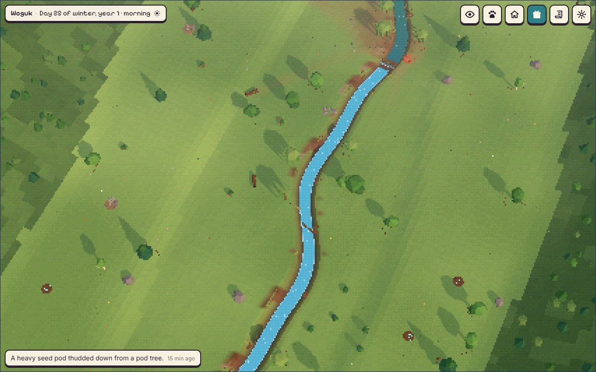
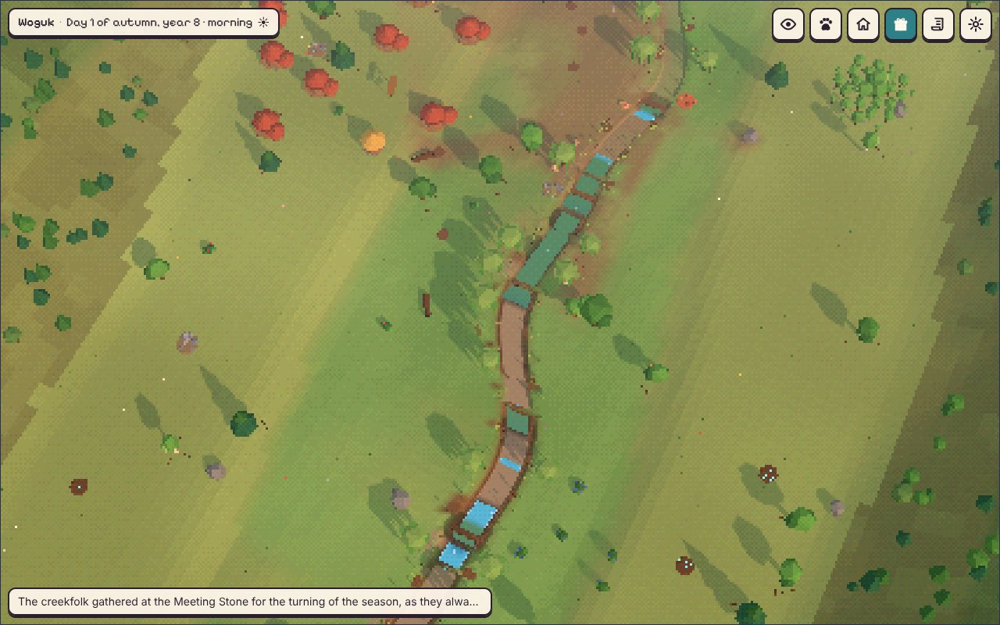
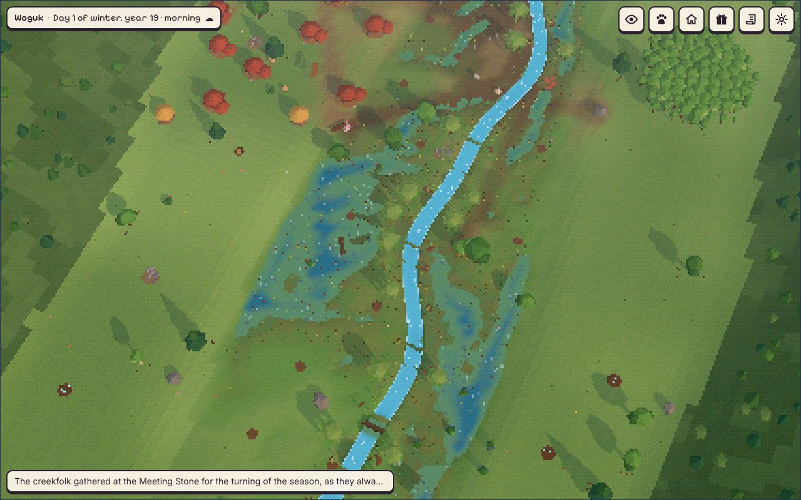
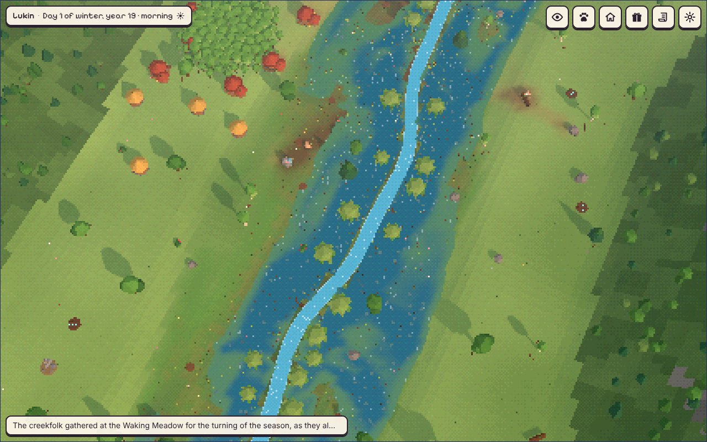
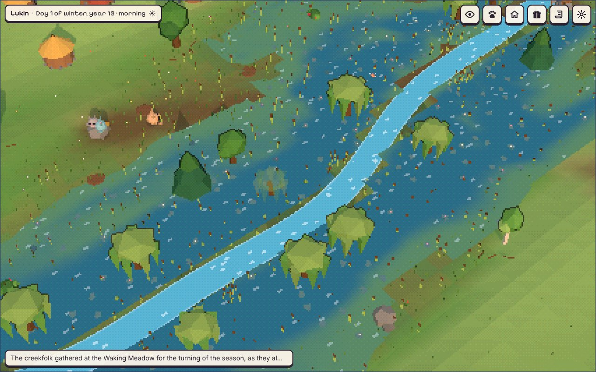
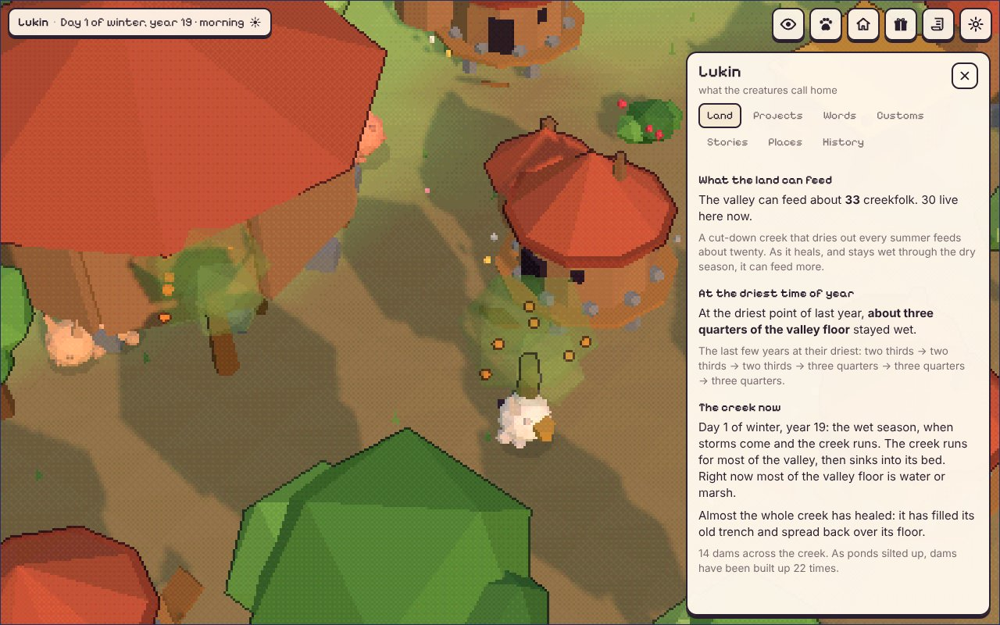

# Phase 3A report: the land

Two files: `creekfolk.html` (the game) and `creekfolk-dev.html` (the same game with a
Dev button and its own saves). This build is version `3a`; it keeps its valleys in its
own storage and never opens a Phase 1 or 2 valley (those still open in their own files
in `releases/`).

## What exists now

**A valley that dries out, and heals.**
- **The 8-day year.** A valley year is 192 valley days, about 8 real days: spring,
  summer, autumn and winter, two real days each. The clock reads "Day 12 of spring,
  year 3". Winter and spring are the wet season, with storms; summer and autumn are dry.
- **A bigger valley.** 160 m along the creek and 80 m across (it was 64 x 64): a valley
  floor along the creek, terraces on both sides where the village lives, hills at the
  rim, the creek leaving through gaps at both ends. The village starts at the upstream
  end, up on the terrace away from the water. The spring is beyond the upstream end.
- **The creek is a model, not a curve.** Creek Care's river model, ported and scaled
  down to a small stream (about 2.4 m wide when healthy): a chain of nodes every 2 m,
  each with a bed, the old valley floor it has cut down below, a trench, maybe an
  inset bench, plants and the water table beside it. It starts cut down about a metre
  below its floor and fairly straight.
- **Every storm is a flood** (about 8 a valley year, about 350 in a real year), sized
  and routed the way Creek Care does it (flow from drained area, Manning's equation,
  Meyer-Peter and Muller gravel transport, mud settling on the floor when water goes
  over the bank). **The creek only gets better:** gravel and mud settle and are never
  dug out again below what has settled; banks don't fall back; dams never wash out.
- **Wet and dry, as real logic.** Every 10 minutes the spring and the hills feed the
  creek, the creek trades water with the water table under the floor (a deep trench
  drains the floor fast; a creek near the top of its floor holds it up), ponds fill,
  spill, evaporate and seep, rain wets the topsoil and warmth dries it. Early on the
  creek stops flowing in the dry season and the whole valley goes from green to straw
  to dusty brown. A pond holds water through the dry season and keeps a green ring
  around it. As the creek fills its trench, the floor stays wet longer each year.
- **Dams and the drop rule.** A dam can hold water at most 0.42 m above the water just
  below it. A tall dam with nothing below it lets the water dig under and its pond
  barely fills (so a lone weir that is heightened into a mud dam gets a *smaller* pond).
  Creekfolk nearby notice ("the pond behind the mud-packed dam won't fill: the water
  slips out underneath it"); an elder can work out why, and that becomes knowledge
  they teach and can lose ("to build dams from the bottom of the creek up"). With it
  they pick sites where the pond below already holds water against the new dam's
  foot, don't heighten a weir that has no water below it, and lay a stone apron under
  the lowest dam before building it up. Silted-up ponds are built up a hand higher as
  an ordinary chore, up to a little above the floor. Up to 14 dams.
- **Stage 0.** Where floods spill over the bank, the water is routed across the floor
  and wears shallow side channels that deepen with every flood that follows them. A
  healed floor becomes channels, pools and marsh rather than one creek. Each stretch of
  creek is classed on the channel-evolution stages (II cut down, IV refilling, V healed,
  I steady, 0 valley-floor wetland).
- **What the land can feed.** Capacity is the lower of shelter (the old formula) and
  what the land can feed: about 20 in a cut-down valley, rising toward 36 as the creek
  heals (wet at the driest point, healed stretches, ponds).
- **In the game:** the village sheet has a new first tab, **Land**: "The valley can feed
  about N", "At the driest point of last year, about a quarter of the valley floor
  stayed wet", the last few years at their driest, and the creek now. Gardens go at the
  edge of the valley floor and stay damp from below once the creek heals.

**Drawing from the model.** The ground's heights come from the model and are rebuilt
after every flood. The creek's trench is its own smooth mesh along the centre line;
its water is a ribbon at each node's water level, so it narrows, stops and dries in the
dry season; water standing on the floor is drawn wherever the water table is above the
ground, so its edges follow the floor's hollows and side channels. The land fades from
green to straw to brown in the dry season, and marsh colours where it is wet.

**The dev build.** A Dev button that works on a phone; its own storage; a snapshot
before every jump (the last ten, each restorable); jumps of a day, a week, 1, 3, 6 or 12
months (all replayed in full); a gift with no wait; a storm, a big flood, a birth, a
passing, a visitor; overlays for wetness, worn paths, creek stage and land capacity;
pause; the creek in numbers; the mind reader. After each jump it shows how fast the
replay ran and how long 30 days would take on that device. During long catch-ups it
says "Keep the screen on until it's done" and holds a screen wake lock where the
browser allows it.

## Measured
Everything here was run on the final build unless it says otherwise. "Tested" means I ran
it and read the result; anything I estimated says so.

**The year arc, whole valleys** (`tools/year.cjs`, two seeds, 210 days each, the gift
given twice a day; `runs/p3a-arc7.txt`). "Driest" is the share of the valley floor that
stayed wet at the driest point of the last valley year; "feed" is what the land can feed.

| Day | Valley 1: creekfolk, driest, dams | Valley 2: creekfolk, driest, dams | Feed |
|---|---|---|---|
| 10 | 12, 1%, 3 | 14, 0%, 2 | 21-22 |
| 30 | 22, 12%, 13 | 19, 9%, 11 | 26 |
| 60 | 17, 9%, 13 | 19, 9%, 14 | 25-26 |
| 90 | 20, 15%, 13 | 22, 23%, 14 | 26-28 |
| 120 | 20, 33%, 13 | 26, 70%, 14 | 29-33 |
| 150 | 20, 54%, 13 | 30, 80%, 14 | 32-33 |
| 180 | 31, 65%, 13 | 23, 84%, 14 | 33 |
| 210 | 27, 74%, 13 | 23, 84%, 14 | 33 |

Against your table: months 1-2 "pools, but the valley still dries out" (9-12% wet at the
driest, it matches); months 2-4 "patches of marsh survive" (15-33% in valley 1; valley 2
is ahead, 70% by day 120); months 4-6 "most of it" (54-84% by days 150-180, it matches);
month 7, 74-84%. The whole floor wet all year (months 6-9) is left for the beavers in 3C.
Population: "about 20" in months 1-2 matches; "close to 36" by months 4-6 does not (see the
notes). Other numbers from the same runs: births 166 and 185, passings 138 and 146, went
downstream 10 and 23, visitors 7 and 15, dams built up (raised) 20 and 32 times, no skill
ever lost; "build downstream first" was worked out within the first ten days in both
valleys and everyone knew it by day 20. The bed stayed smooth
(bumpiness at most 0.05 m for the bed, 0.002 m for the floor). No simulation errors.
The year runner's targets all passed, but read the population one closely: "most valleys
reach 30 between month 2 and month 6" passed on valley 2 (day 112); valley 1 first reached
30 on day 203.

**The creek alone** (`tools/creek-lab.cjs`, scripted dams like the creekfolk build, no
creekfolk; 200 days): wet at the driest point by valley year (a valley year is 8 real
days): year 1 0%, year 4 3%, year 7 (day ~56) 13%, year 10 31%, year 13 (day ~104) 46%,
year 16 53%, year 19 (day ~152) 65%, year 22 76%, year 25 (day ~200) 82%. With no dams at
all: 0% until year 7, 5% at year 13, 13% at year 19, 16% at year 25.

**Catch-up speed** (headless Chromium on my machine, minified build, idle CPU; the same
code path as a real absence: save, replay in a Web Worker, load):
- Phase 2 build, a Phase 2 valley of 29: 30 days in **3.3 min** (measured earlier).
- 3A build, the valley I benchmarked before the late fix (29 creekfolk): **3.8 min**
  (3.7 before the fix, so the fix costs nothing measurable).
- 3A build, the final run's valley 2 at day 150 (30 creekfolk, 29 homes, 14 dams):
  **4.6 min**. The time goes into the creekfolk (choosing, routing round homes and dams),
  not the creek: in a profile no creek function was in the top fifteen.
- So 30 days went from about 3.3 to about 4-4.6 minutes on this machine, well under your
  guess of 6-10. In Node (no browser) the full runs went at 11,300-12,600 times real time.
- **Phones: not measured.** I have no phone. CPU throttling in Chromium is not a fair
  stand-in (it doesn't slow the worker evenly). If your phone is 3 to 5 times slower than
  this machine, 30 days would take roughly 12 to 23 minutes; that is a guess. The dev build
  shows the real figure after any jump ("30 days would take about N min here").

**Determinism** (`tools/determinism.cjs`): one replay, uneven slices and repeated
save-and-reload give the identical state hash, for 6 days and for 20 days.

**In the browser** (`tools/browser-test.mjs`, `tools/browser-dev.mjs`, both on the final
minified build): a new valley; a 3-day jump through the worker in 6.4 s; reload gives the
same valley; no errors. The dev build uses its own database (`creekfolk-3a-dev`); +1 day
replayed in 3.0 s; the snapshot before it is listed and restores; storm, birth, gift and
overlay buttons work; pause holds the clock (0.01 s in 3 s); a Phase 2 save is refused
with your wording.

**Saves** at day 210: 1.5 to 1.7 MB.

## Pictures
From the final runs (`docs/img/`):
- Week 1, valley 1: the creek cut down in its trench, the first dams.
  
- Day 60, start of autumn: the dry season. The ground has gone to straw, stretches of the
  creek have stopped flowing, the ponds still hold water.
  
- Day 150, the driest point of the year, valley 1 (54% of the floor wet): marsh spreading
  along the floor's hollows on both sides of the creek.
  
- Day 150, valley 2 (80%), from above and close up: a marsh with willows and reeds, the
  creek running through it.
  
  
- The Land tab, and the dev menu.
  
  

## Honest notes
- **The whole floor is not marshy all year by month 9.** At the driest point the runs
  reach "most of it" between months 4 and 6 and 74-84% by month 7, still rising slowly.
  Getting the last of the floor wet is what the beavers are for in 3C.
- **Dams come faster than the table.** Creekfolk build 11 to 13 dams by day 30 and 13 or
  14 by day 60 (the table says "several by months 1 to 2"). The healing is still paced by
  mud and by building dams up, which is slow, so the arc keeps its shape; but the creek
  fills up with dams early. Easy to slow down if you'd rather.
- **The creek's main channel doesn't move.** Creek Care's bends migrate; here the main
  channel keeps its starting course (so it can never undercut a home), and the wandering
  comes from the side channels on the floor instead.
- **Time is compressed, so some rates are chosen, not measured.** A valley year is 8 real
  days. Flows are real (cubic metres per second) but evaporation, seepage and the slow
  water from the hills are set per valley day so the year behaves as the author's table
  asks: a first pool lasts through the dry season, a cut-down valley dries out, a healed
  one doesn't. Sediment yields are tuning knobs (`CREEK.fineYield`, `gravelYield`), not
  calibrated to a real watershed.
- **"Build downstream first" is learned fast and never lost.** An elder works it out in the
  first one or two weeks in every run, and it's taught to everyone. No skill was lost in
  any run again.
- **The population lags the land.** What the land can feed reaches 32-33 by months 4-5,
  and shelter allows 36, but the population swings between about 17 and 31 in waves (a
  generation passes, the young leave once the valley is 85% full). "Close to 36 by months
  4 to 6" isn't reached. This is births and leaving, not the land; 3C changes life and
  the ending, so I'd tune it there unless you want it now.
- **Looks are 3A-level.** The creek, ponds, marsh and side channels are drawn from the
  model, and shallow water over the floor is tinted as marsh with deeper pools in blue,
  but water edges still follow the 1 m grid, the cut banks are simple, and a healed valley
  in the wet season is mostly water. Phase 4 is the place for this.
- **A bug I found late, and fixed.** Checking screenshots, I found the creek's bed growing
  into a sawtooth over the year (up and down by up to a metre between neighbouring 2 m
  nodes), with the floor rising in strips that drew as bands across the valley. The cause
  was how each node's slope was worked out: humps looked flat and kept catching gravel,
  pools looked steep and never filled. Now water stands in a pool behind a hump the way
  it does behind a dam, so pools fill and humps don't, and a bumpy bed smooths itself.
  All the numbers below come from runs after the fix. The earlier numbers I sent you
  came from the buggy model.
- **An undammed creek now heals slowly by itself.** A side effect of the fix: in the lab,
  with no dams at all, the trench fills from about 1 m to 0.5 m over 200 days and the
  floor wet at the driest point reaches about 15% (82% with the lab's dams). Before the
  fix it stayed at 0%. Real cut-down creeks do slowly recover on their own, so I've left
  it. If you'd rather the valley stayed dry without the creekfolk, the knobs are the
  sediment the floods bring (`CREEK.fineYield`, `gravelYield`), which would also slow the
  dammed creek, so they'd need retuning together.
- **Not built yet (later parts):** beavers and the Returning (3C; disabled buttons in the
  dev menu), the sky calendar (there was none before; `daysToMidwinter()` is ready for it),
  then-and-now (the day-one creek is saved, ready for 3C).

## What I'd do next
- **3B: belief and the temple.** The creek as the giver; requests from `giftNeed`
  ("the gardens are dry"); believers gathering at the giving place when a gift is due;
  offerings left for you; "the creek gives at dawn, every twenty-four days"; the new
  gifts (goats, bees, fish, birds, flower and fruit seeds, snow day, starry night,
  rainbow, a fallen tree, clay, stones, a dream); the temple's three stages paced by your
  giving; the one who believes in you.
- Before that, if you want: slow the first dams down, or speed up the population so the
  valley gets closer to what the land can feed.
- One thing only you can measure: open `creekfolk-dev.html` on your phone, press Dev,
  jump +1 week, and read the line "30 days would take about N min here".
