# Phase 3B report: belief and the temple

Two files, as before: `creekfolk.html` (the game) and `creekfolk-dev.html` (the same game
with a Dev button and its own saves). This build is version `3b`; it keeps its valleys in
its own storage and doesn't open 3A valleys (those still open in the 3A files in
`releases/`).

## What exists now

**The creek gives.** The creekfolk come to believe the gifts come from the creek. The
feeling is gratitude and kinship: the first to believe says "The creek keeps us, and we
keep the creek." Everyone who is awake notices a gift (those who saw it most), children
grow up with most of their family's belief, and belief passes in chats. About one in seven
of the grown-ups, the least open of their own valley, keep saying it's only luck, and
believers and doubters argue now and then. Their word for the creek-that-gives spreads like
any other word.

**The Giving Place.** The first believer goes down to the creek's edge below the village to
thank it, and that spot becomes the Giving Place, a named place. The ground around it is
kept clear for the temple.

**They ask.** A believer says out loud what the valley needs most, from what the simulation
knows would help: "Wren went down to the water and asked the creek for rain. 'The gardens
are dry,' they said." The request stands until the next gift and shows at the top of the
gift sheet, with its button highlighted. Giving what was asked is an answered request:
belief grows about twice as much, and "Wren asked the creek, and the creek answered" goes
in the log and in Wren's memory.

**They expect you.** When a gift is due, believers take turns keeping watch at the Giving
Place in daylight, two or three at a time. Once they know your rhythm, they gather at the
hour you usually come. If the gift comes while they watch, they celebrate.

**They give back.** Sometimes, keeping watch, one of them leaves something for the giver: a
carved bead, a flower, a pretty pebble, a woven ring of grass, a feather, a creek shell, a
reed whistle, a little clay figure; later, cups of water carried back from the Spring. They
collect at the Giving Place (the last forty are drawn there) and the gift sheet counts them
all: "Left for you at the Giving Place: 23 carved beads, 17 flowers and 9 feathers".

**They remember.** Gifts become stories (as in Phase 2). Every gift is a notch on the Giving
Stone ("They mark every giving day with a notch on the Giving Stone: 140 so far"). The place
of the first gift is named, if it had a place.

**The rhythm.** Gaps are counted in valley days, so they never say "twice a day". When the
last few gifts came at the same interval they notice it, and if they also came at the same
time of day, that too: "Tuck has noticed that the creek gives at dawn, every forty-eight
days." If your rhythm changes, they notice the new one.

**When you're away.** After three real days with no gift (or half again the gap they're
used to, if you usually come less often than that): "The gifts haven't come for a
while. 'The creek is resting,' Wren says. They left a lantern burning at the Giving Place,
so the creek will know where to find them." The lantern burns until the next gift. Belief
fades very slowly. Nothing asks what they did wrong.

**Seventeen gifts in four groups.**
- Weather: a gentle rain, a warm day (both kept), a snow day (the valley turns white for a
  valley day, children play in it, it melts into the soil), a starry night (they lie out in
  the meadow and watch; from above you see the stars in every pond and pool), a rainbow (a
  short shower, then an arc over the valley; a sign, so belief grows more).
- Living things: a scatter of seeds (kept); flower seeds (a kind of flower the valley
  hasn't seen, which spreads in patches; six kinds); a fruit tree (three young trees of a
  new fruit near the homes; five kinds); a pair of goats (named by the creekfolk, graze near
  a pasture, tended for company, never for meat); bees (a hive by the gardens, which grow a
  quarter faster); fish (a new kind in the ponds and pools; four kinds); a new bird (six
  kinds, the owl only at night).
- Materials: a fallen great tree (timber), a bank of good clay, a pile of stones, each near
  the village.
- Wonder: something to find (kept), and a dream: one of them wakes with an idea that
  matters now, in this order: a lost skill remembered, the next part of the temple seen
  clearly (it comes sooner), the way to the spring, or plans for something new.
Each living gift adds a species the valley didn't have, so valleys end up different. Gifts
still never decide survival.

**The temple.** It begins when there have been at least 7 gifts in the last 14 real days,
most of the village believes, and the valley is at least a week old (so week 2 at the
earliest). It rises at the Giving Place in three stages of twelve parts:
1. The shrine: stacked stone (the first stone, base course, second and third courses,
   capstone), an offering ledge, a clay water bowl, a lantern niche, a path of stones, two
   standing stones, a carved marker, and the planting of the temple wood.
2. The hall: footings, a stone floor, timber posts and beams, clay walls that cure, three
   carved panels, roof battens, a clay-tile roof, a door with lanterns.
3. The crown: a stepped pyramid of five terraces and a top step, its great stones moved
   only in the dry season; a clay channel and cistern; creek water running down its steps;
   a sun gate turned toward their midwinter sunrise; the crown stone.
A part unlocks when the village feels the creek has answered enough; that feeling builds at
the pace you set by giving (about every 4 days: half speed; every other day: full speed;
daily: 1.2 times; twice a day: 1.4 times; six days with no gift: it stops, and nothing is
lost). Then they build the part with ordinary labour and materials. Timber comes from the
trees they plant as part of the shrine (about a month to grow) or a fallen great tree;
clay walls and channels must cure (and don't dry in the rain); crown stones wait for the
dry season. Each carved part records the story most of the village tells at that moment,
in their version of it, and a carved story drifts half as fast afterwards. While the temple
waits, they say "We'll wait for a sign", tend it, and leave small gifts; after a few days a
story grows up about the half-built temple.

**A valley with no giver** begins the Hall of the Ancestors near the memorial grove on day
30 instead: a ring of carved ancestor stones, a hall, and a lantern tower, the same
machinery at full speed on time alone, tuned to finish in the middle of month 11 like an
every-other-day temple. If gifts start later, the temple can still begin.

**The spring.** Once a third of the village believes, the next visitor or traveler brings
news: "the creek begins at a spring, up past the head of this valley, where the water comes
up out of the ground under a mossy stone." (If no one comes, a curious elder starts
wondering after about two months; a dream can send someone too.) An explorer walks up to
the head of the valley and on, out of sight, for half a valley day, and comes back having
found it. The Spring becomes a named place and the holiest place they know; from then on a
believer makes the journey now and then and brings back a little of its water. Their
belief takes the "someone watching" idea into the creek: the gifts come from where the
creek begins.

**The one who believes in you.** After about five months of steady giving (and at least a
hundred gifts), one creekfolk becomes sure the gifts come from someone beyond the valley. It still thanks the creek, "but
when they think no one is looking, they wave at the sky". When you open the game (or come
back to the tab after a while), it turns to face the camera and waves, and a note says so.
Its friends think it's an odd idea but are fond of it. When it passes or goes downstream,
the belief goes to one of its children or a younger friend, so it runs through a family.
One at a time.

**In the game.** The gift sheet lists the seventeen gifts in their four groups, with the
standing request at the top and what has been left for you at the bottom. The village sheet
has a new Temple tab: what they believe, the request, the notches, the offerings, the
temple (parts built, what's next, how readily the creek answers, the latest carvings) or
the Hall of the Ancestors, the Spring, and the one who believes in you. The dev menu has
every gift, plus "the creek answers now", "find the spring", "one believes in you" and
"everyone believes".

## Measured
Everything here was run on the final build unless it says otherwise. "Tested" means I ran
it and read the result; anything I estimated says so. The year runs are whole valleys,
every moment simulated, 330 days each (`tools/year.cjs`, results in `runs/final/`). The
simulated player gives on a rhythm, give or take half an hour, and three times in four
gives whatever the valley needs most (mostly warm days, snow, starry nights and rain).

**The temple's pace.**

| Giving | Valleys | Temple began | Shrine done | Hall done | Crown done (finished) | Made do |
|---|---|---|---|---|---|---|
| Every other day | 2 | day 12.6 | days 106.4, 106.3 | 207.6, 208.2 | **314, 306** (month 11) | 0 |
| Daily | 1 | day 7 | 84.9 | 167.4 | **261.6** (month 9) | 0 |
| Twice a day | 1 | day 7 | 74.0 | 148.6 | **220.3** (month 8) | 0 |
| About every four days | 1 | never (three or four gifts in fourteen days) | Hall of the Ancestors from day 30: stones 120.9 | hall 218.7 | lantern tower **314.6** (month 11) | 0 |
| No giver | 1 | never | Hall of the Ancestors from day 30: stones 121.0 | hall 218.7 | lantern tower **314.6** (month 11) | 0 |

**When the giving changes** (one valley each, the same valley as every-other-day valley 1
until the change):
- **Every other day, then every four days from day 90:** a part every 8.3 days until then,
  then every 14.7 to 17.4 days (half speed would be 16.5); 17 of 36 parts by day 200.
- **Every other day, then nothing from day 100 to day 112:** on day 101.6, three days after
  the last gift, they said the creek was resting and lit the lantern; on day 104.6 the
  temple stopped ("We'll wait for a sign"); on day 112.0 the next gift came and the
  builders took up their tools again. Nothing was lost: the part under way took 19.9 days
  instead of 8.3, the next one 9.8 while the pace built back up, then 8.3 again. At day 160,
  13 of the 25 told the story of the time the temple stood half-built.

Against what you expected:
- **Every other day, mid month 11** (day 315): day 314 in one valley; day 306 in the
  other. The simulated player gave one dream in each valley, and a dream brings the next
  part closer; in the second valley it came just as a stage began and saved about four
  days. Without dreams the earlier build finished on day 314 in both valleys.
- **Daily, about month 10:** day 261.6, in month 9, about three weeks before month 10
  begins. This is the pace table at work: 1.2 times full speed on a year tuned to mid month
  11 lands in month 9.
- **Twice a day, about month 8.5:** day 220.3. If you meant the middle of month 8
  (day 225), it is five days early; if you meant eight and a half months in (day 255), it
  is a month early.
- The material clocks add little: about two days to the hall (curing clay) and up to a
  week to the crown (its great stones wait for the dry season, at most about three days a
  part), so the pace table decides nearly everything. To land daily in month 10 the table
  would need about 1.08 for daily; twice a day already matches "the middle of month 8" at
  1.4.
- Labour and materials never held a part up: "made do" (a part stuck five days) happened
  0 times with a giver.

**Belief and the loop** (the same runs):

| Giving | First believer | Most believe by | Believe at day 330 | Requests (answered) | Offerings left | Spring heard / found | The one who believes in you |
|---|---|---|---|---|---|---|---|
| Every other day | days 8.6, 6.6 | day 14, day 7 | 26/28, 24/26 | 253 (66), 256 (65) | 802, 805 | 22.7 / 23.0, 18.4 / 18.7 | first on day 199 in both (the hundredth gift); then 9 and 10 holders in turn |
| Daily | day 5.3 | day 7 | 23/26 | 251 (123) | 1,602 | 11.0 / 11.3 | day 150 (five months); 11 holders |
| Twice a day | day 3.2 | day 7 | 23/26 | 451 (265) | 490 | 20.6 / 20.8 | day 150; 11 holders |
| About every four days | day 29.2 | day 35 | 20/23 | 214 (23) | 411 | 51.6 / 51.9 | never (83 gifts in the year) |
| No giver | | | 0/27 | | | never heard of it | |

"Most believe by" is the first weekly check with more than half believing. Two or three in
each village didn't believe at day 330: the doubters. Offerings: about five new ones for
each visit when you come every other day, daily or every four days; under one a visit
twice a day, because the gift comes before anyone has started keeping watch. The one who believes in you passes the belief on when they
pass or leave, so it moves through the village about every two to three weeks; there was
never more than one at a time.

**When you stop giving** (`tools/away-test.cjs`: a gift every other day for two months,
then none; `runs/final/away.txt`). The creek was "resting" from day 61.5 and the lantern
stayed lit. Believers: day 60, 20 of 22; day 76, 18 of 20; day 92, 24 of 28; day 96, 21
of 26; day 100, 16 of 26; day 104, 13 of 24; day 108, 5 of 24; day 120, none. So most
still believed five weeks after the last gift, about half at six to seven weeks, and none
at nine weeks, when nearly everyone alive had been born after the last gift. The story of
the waiting temple was told by 13 to 24 of them throughout. Before the fix (see the notes)
belief fell below half within about ten days.

**The rest of the valley** (the same runs): population at day 300 between 26 and 32;
births 283-302, passings 233-249, gone downstream 28-49 in 330 days; no simulation errors;
no skill lost. The year runner's population target ("most valleys reach 30 between month 2
and month 6") failed in the twice-a-day valley (first 30 on day 203); that is the
population swing from 3A, untouched in 3B. Saves at day 330: about 2 MB (1,999 to 2,101 KB; 3A:
1.5 to 1.7 MB at day 210). In Node the year runs went at 9,000 to 11,100 times real time,
two at once on this two-core machine.

**Determinism** (`tools/determinism.cjs`, 20 days, every gift given in turn): one replay,
uneven slices and repeated save-and-reload give the identical state hash.

**In the browser** (headless Chromium, final minified build):
`browser-test.mjs`: a new valley, a 3-day jump through the worker in 6.5 s, the same
valley after a reload, no errors. `browser-dev.mjs`: the dev build keeps its own database
(`creekfolk-3b-dev`); +1 day in 3.0 s; the snapshot before it restores; storm, birth, gift
and overlay buttons work; pause holds the clock (0.01 s in 3 s); a Phase 2 save is refused
with your wording; no errors. `browser-gifts.mjs` (new): all 17 gifts and every trigger in
the dev menu, with the valley drawn between them, no errors.

**Catch-up speed** (headless Chromium on this machine, minified build, the same code path
as a real absence): every-other-day valley 1 at day 300 (30 creekfolk, the temple at 34 of
36 parts): 30 days in **5.5 min** (7,800 times real time). 3A measured 3.8 to 4.6 min for
30 creekfolk at day 150; re-measured today on the same machine, the 3A release takes 4.1 min
on its day-150 valley (29 creekfolk), and this build takes 5.0 min on a younger 3B valley
(day 180, 25 creekfolk). So 3B costs roughly a fifth more than 3A for a similar village,
perhaps a little more (that 3B valley had fewer creekfolk); I can't run both builds on the
same valley, since each build reads only its own saves. In a profile of the day-300 valley
(Node) no 3B code was among the top twenty functions; the time goes where it went in 3A,
into creekfolk choosing what to do and finding their way round the village.
**Phones: still not measured by me.** If a phone is three to five times slower than this
machine, 30 days would take roughly 16 to 28 minutes; that is a guess.

## Pictures
From the final runs (`docs/img/`), unless it says otherwise:
- Day 60, every other day: the shrine at the Giving Place, with offerings around it and the
  water bowl on its ledge (an earlier run of the same valley).
  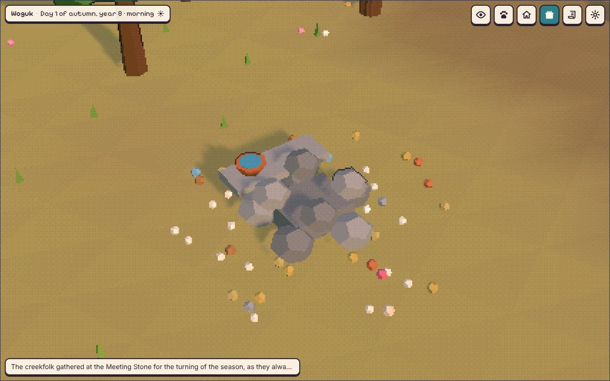
- Day 120: the shrine done and the hall's footings laid (an earlier run).
  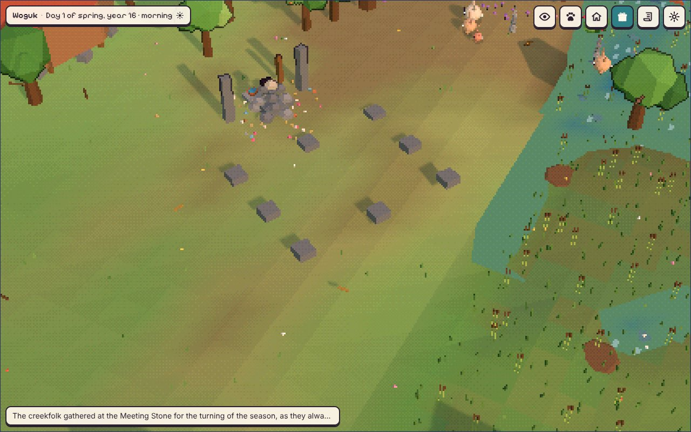
- Day 240: the hall finished, the crown's first terraces.
  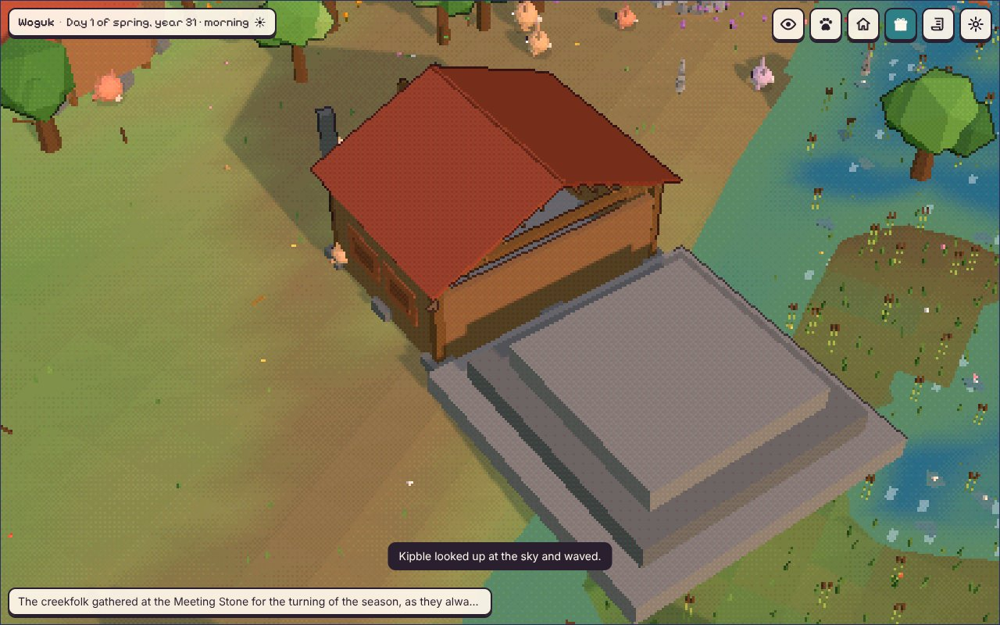
- Day 330: finished. The hall, and the crown with water running down its steps and the
  sun gate on top, turned toward their midwinter sunrise. "Dillmo looked up at the sky
  and waved" is the one who believes in you.
  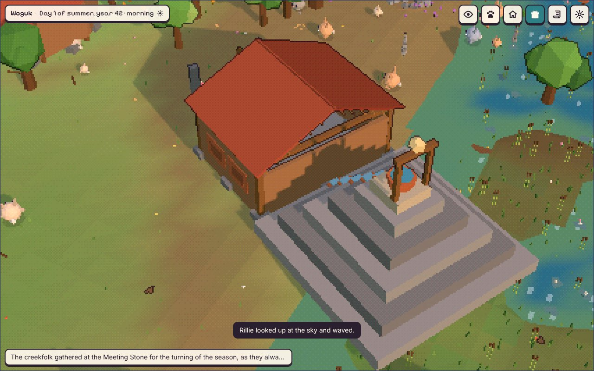
  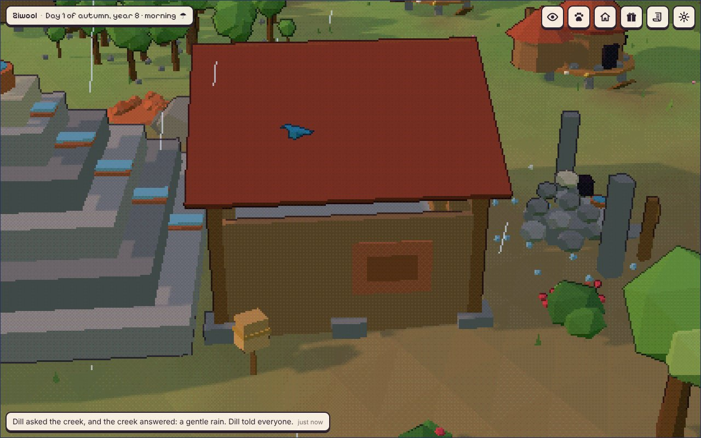
- A valley with no giver: the Hall of the Ancestors, its ring of stones and lantern tower,
  in the memorial grove, day 330.
  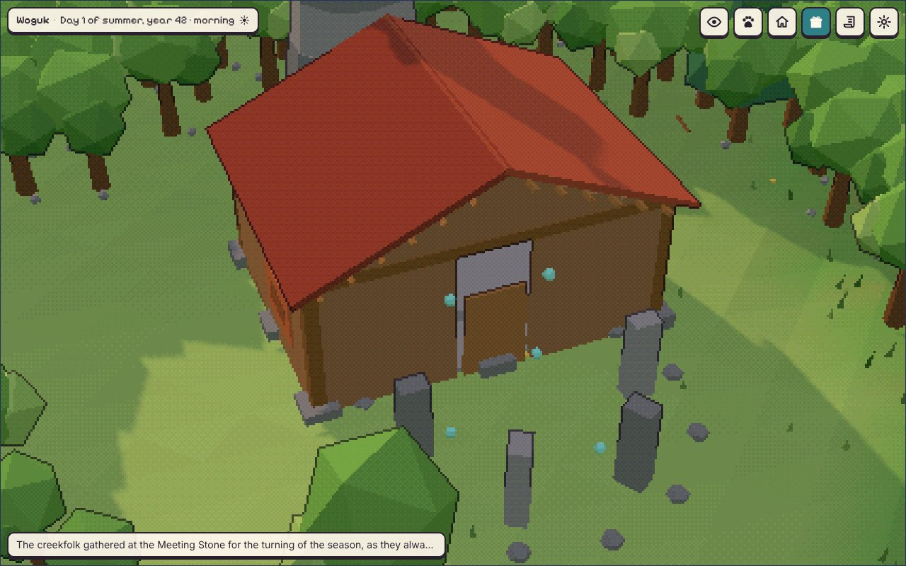
- Gifts (from earlier runs while building): a pair of goats under a new fruit tree, with new
  flowers; a snow day; a starry night (seen in the water); a rainbow.
  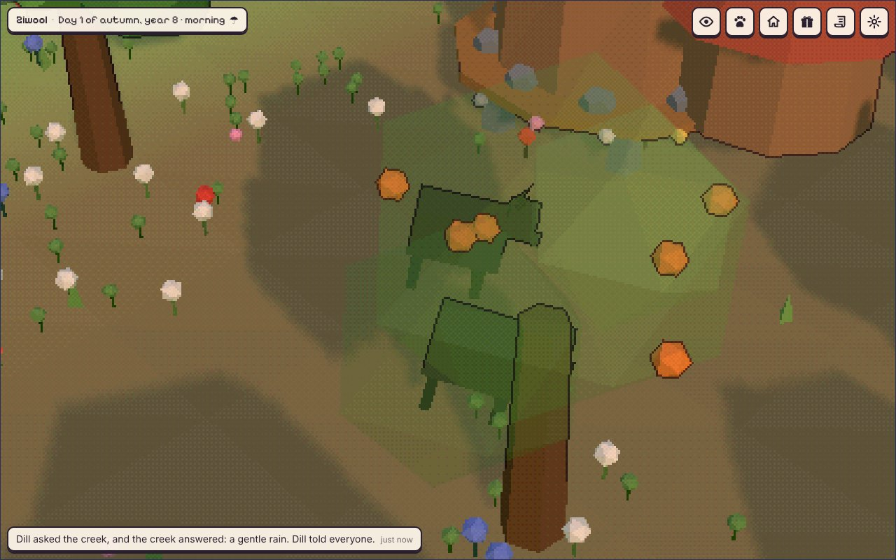
  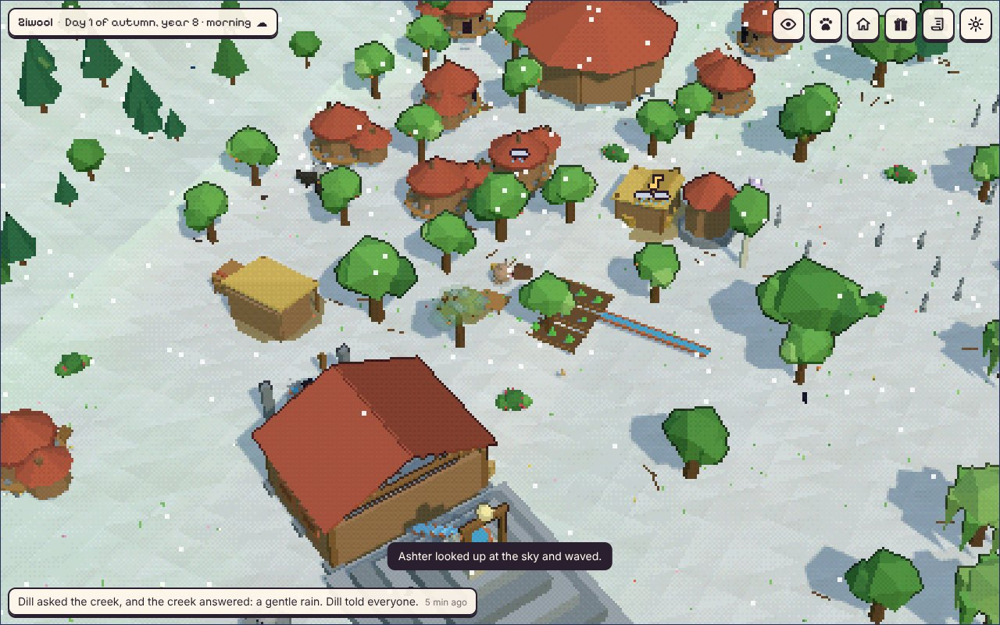
  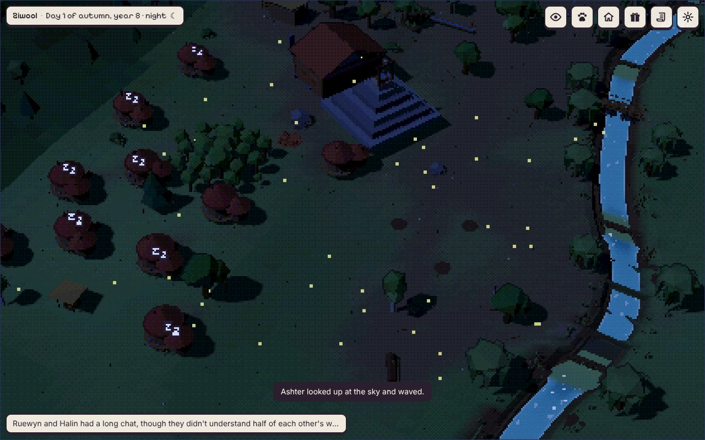
  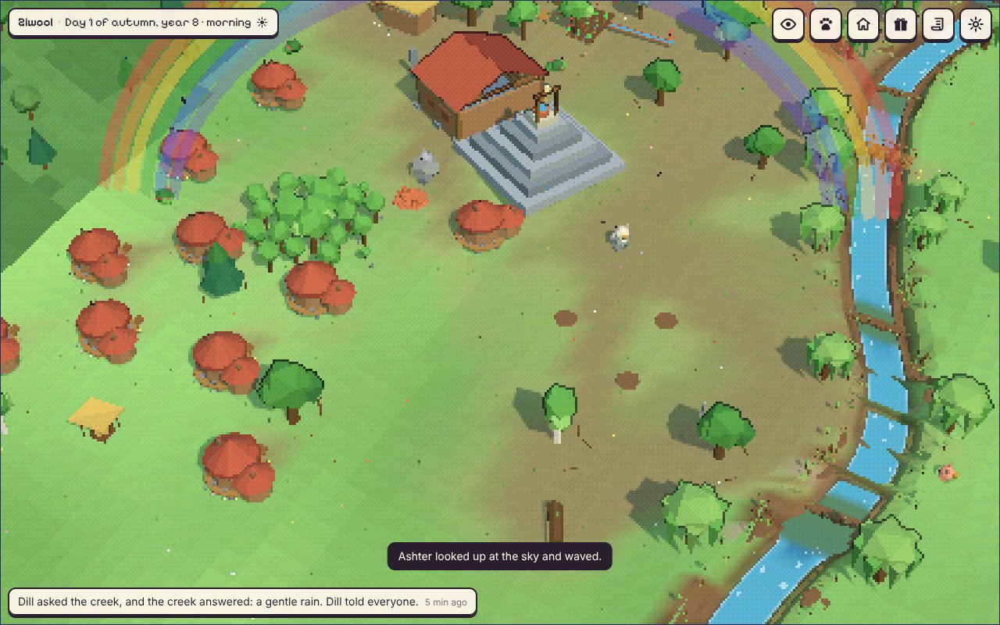
- The village's Temple tab, the gift sheet, and the dev menu.
  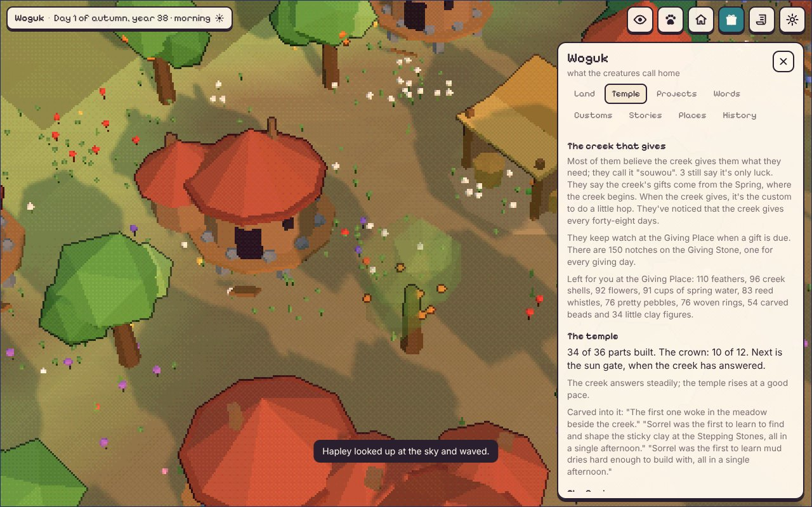
  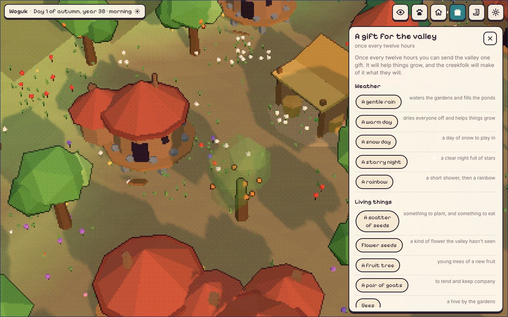
  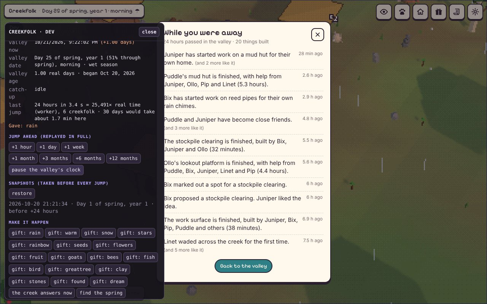

## Honest notes
- **Daily givers finish about a month sooner than you expected.** With every other day
  tuned to the middle of month 11, the pace table's 1.2 for daily lands in month 9 (day
  261.6), not "about month 10". Twice a day (1.4) lands in the middle of month 8 (day
  220.3), which matches "about month 8.5" if that meant halfway through month 8. I followed
  the table. If you'd rather have month 10 for daily, its multiplier would be about 1.08
  (one line, `paceOfRate` in `temple.js`).
- **Dreams speed the temple up.** A dream shows them the next part, which then comes
  sooner (up to about four days). A player who sends dreams will finish a little earlier
  than the table says.
- **A player who gives about every four days from the start never gets a temple**, even
  though most of their village comes to believe (28 of 31 at day 330): the start rule needs
  seven gifts in fourteen days. They get the Hall of the Ancestors instead, as the brief
  says for valleys that never reach the threshold. Half speed applies to a temple already
  begun when the giving slows. If you want slow givers to get a temple too, the start rule
  would have to change.
- **Building is fast once a part is unlocked.** Labour and materials take hours, not days,
  because by then the village has little else to build. The waits that matter are curing
  clay and the dry season for the crown's stones. Labour and materials were never the
  bottleneck: no part was ever stuck long enough to "make do" in the final runs.
- **A fix that touches every building.** Work already under way when a stage started
  curing used to finish it at once, so clay never really dried (an old bug from the
  original game). Now work done while something cures doesn't count. Mud huts, kilns and
  the rest take a little longer to finish; all the runs here include it.
- **Belief while you're away needed a fix.** When the gifts stopped, belief used to fall
  below half the village in about ten days: each new generation started with three
  quarters of its parents' belief, and doubters talked the rest down. Now children start
  with most of their family's belief, and while the creek rests belief fades very slowly
  and doubters barely sway believers. Most still believe five weeks after the last gift.
- **Late fixes, and which runs they touch.** After some of the year runs I found two more
  things: bees sometimes couldn't be placed in a young valley ("That gift can't be given
  just now"), and the memorial grove could grow into the temple's ground (86 trees inside
  it by day 330 in two valleys) or over the Hall of the Ancestors. Both are fixed. I re-ran
  the daily, twice-a-day, every-four-days and no-giver years on the final build; the
  every-other-day, slowing and pausing runs are unchanged by these fixes (no gift failed in
  them and their grove never came near the temple), so I didn't re-run them.
- **Offerings pile up for a daily giver**: about 1,600 in a year, about five new ones each
  visit, as for every other day. They're counted, not stored; the last forty are drawn.
- **Requests follow what the valley needs most**, which is usually a warm day or rain;
  materials when a build is short of them; living things rarely, since they're never
  needed. I didn't count them by kind over a whole year.
- **The one who believes in you changes every two or three weeks.** Creekfolk live about
  thirty days and it comes to a grown-up, so it passes along often (9 to 11 holders in a
  year). Never more than one at a time.
- **What you see from above.** The game's camera looks down, so a starry night shows as
  stars reflected in every pond and pool (and in the sky only if you tilt the camera up),
  and the rainbow is drawn as an arc just beyond whatever you're looking at.
- **Looks are 3B-level.** The temple, goats, hive, fish and birds are simple shapes; the
  fruits all look alike. Phase 4 is where they get their art.
- **The wave happens when the page opens** or when you come back to the tab after a
  minute away. It can't know whether you are actually looking.
- **Population still swings** (from 3A): between about 16 and 32, and the year runner's
  "30 by month 6" target failed in some valleys. 3B didn't touch births or leaving.
- **Not built yet (3C):** beavers (the crown doesn't wait for them), goats having kids,
  the Returning and the procession to the Spring, the sky calendar, then-and-now, the
  soundscape, and limits for very long running beyond what 3B keeps bounded (offerings
  are counted, not stored; the forty most recent are drawn; carvings keep the last sixty).
- **Phones: still not measured by me.** See the catch-up numbers above for this machine.

## What I'd do next
- **3C: life and the ending.** Beavers arriving when the floor is wetland (and taking over
  dam-tending, which frees hands for the crown), the Returning on their midwinter with the
  sun through the sun gate, glowing fish up the creek to the Spring, lanterns for those who
  passed; looks you can trace through families, homes, the grove's trees growing all year,
  goats with kids, herons, the soundscape, then-and-now, and two-year runs showing memory
  and save size stay flat.
- Before that, three decisions that are yours: whether daily giving should finish in month
  10 (pace 1.08 instead of 1.2); whether a player who only ever gives every four days should
  get a temple (it would need a different start rule); and whether to tune births and
  leaving so the population follows what the land can feed (from 3A).
- One thing only you can measure: catch-up on your phone (Dev, +1 week, then read "30 days
  would take about N min here").
